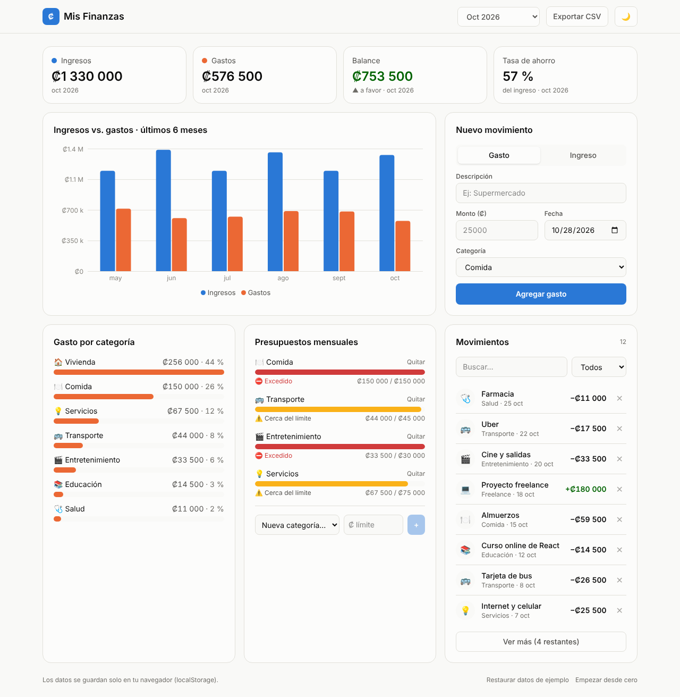
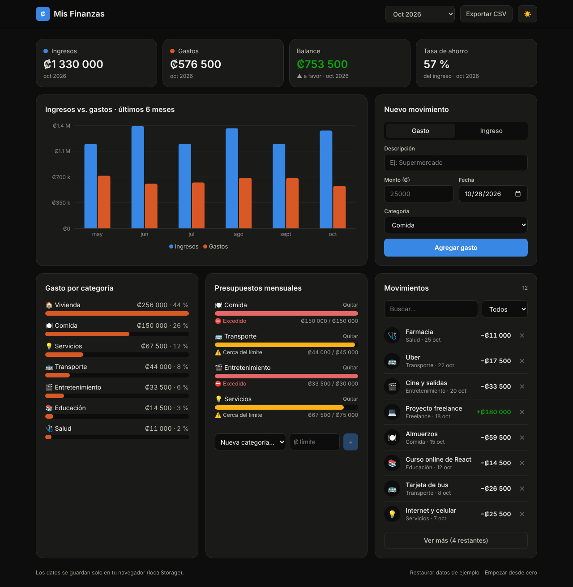
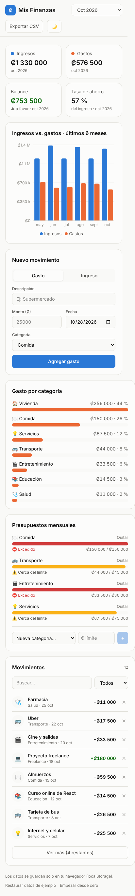

#  Mis Finanzas — Dashboard de finanzas personales

Aplicación web para registrar ingresos y gastos, visualizar en qué se va el dinero y controlar presupuestos mensuales. Hecha con **React 19, TypeScript y Tailwind CSS**.

**Demo en vivo:** [finanzas-dashboard-gamma.vercel.app](https://finanzas-dashboard-gamma.vercel.app)



##  Funcionalidades

- **Registro de movimientos** — formulario controlado con validación (descripción, monto, fecha, categoría).
- **Resumen del periodo** — ingresos, gastos, balance y tasa de ahorro, filtrable por mes o historial completo.
- **Gráfico mensual** — ingresos vs. gastos de los últimos 6 meses (Recharts) con tooltip interactivo.
- **Gasto por categoría** — ranking con porcentaje del total, construido solo con HTML + Tailwind.
- **Presupuestos mensuales** — barras de progreso con estado accesible (color + ícono + texto).
- **Búsqueda, filtros y paginación** en la lista de movimientos.
- **Exportar a CSV** compatible con Excel (UTF-8 con BOM, comillas escapadas).
- **Persistencia en `localStorage`** — los datos sobreviven al recargar.
- **Modo oscuro** que respeta la preferencia del sistema y recuerda la elección.
- **Responsive** — funciona desde 360 px hasta escritorio.

| Modo oscuro | Móvil |
|---|---|
|  |  |

##  Stack

| Área | Tecnología |
|---|---|
| UI | React 19 + TypeScript |
| Estilos | Tailwind CSS v4 (tokens de diseño para tema claro/oscuro) |
| Gráficos | Recharts |
| Build | Vite |
| Tests | Vitest |
| Linter | Oxlint |

##  Decisiones técnicas

- **Lógica separada de la UI.** Todos los cálculos (resúmenes, agrupaciones, CSV) viven en `src/utils/finance.ts` como funciones puras, por eso tienen tests unitarios.
- **Custom hooks.** `useTransactions` concentra el manejo de datos; `useLocalStorage` encapsula la persistencia con manejo de errores (modo privado, almacenamiento lleno); `useTheme` maneja el tema.
- **Estado derivado, no duplicado.** El resumen y los gráficos se calculan a partir de la lista de movimientos con `useMemo`, en vez de guardar copias que podrían desincronizarse.
- **Tipado estricto.** Los tipos de `src/types.ts` impiden, por ejemplo, asignar una categoría que no existe.
- **Accesibilidad.** Labels en todos los inputs, `aria-*` en barras de progreso y botones de ícono, y estados que nunca dependen solo del color.

##  Estructura

```
src/
├── components/     # Piezas de UI (tarjetas, gráficos, formulario, lista)
├── hooks/          # useTransactions, useLocalStorage, useTheme
├── data/           # Categorías y datos de ejemplo
├── utils/          # Funciones puras + tests
├── types.ts        # Tipos compartidos
└── App.tsx         # Composición del dashboard
```

##  Correr el proyecto

```bash
npm install
npm run dev      # servidor de desarrollo en http://localhost:5173
npm test         # tests unitarios
npm run build    # build de producción en /dist
```

##  Próximas mejoras

- Autenticación y base de datos (Supabase) para sincronizar entre dispositivos.
- Movimientos recurrentes (ej. alquiler cada mes).
- Tests de componentes con React Testing Library.
- Soporte multimoneda (CRC / USD).

---

Hecho por **David Brenes** · [LinkedIn](#) · [GitHub](#)
